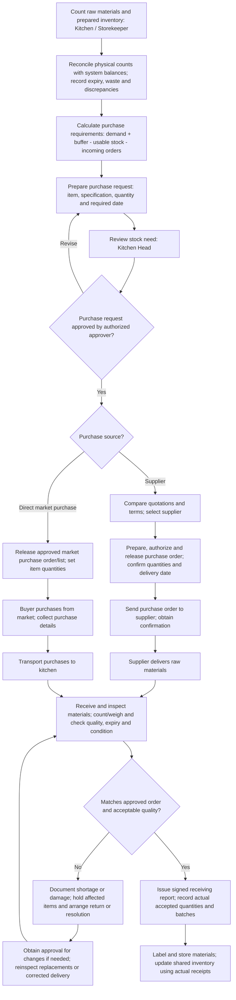
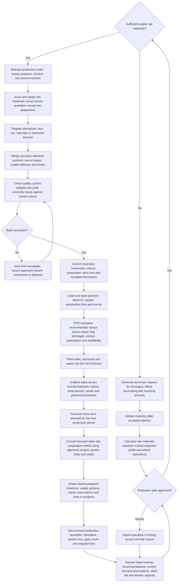
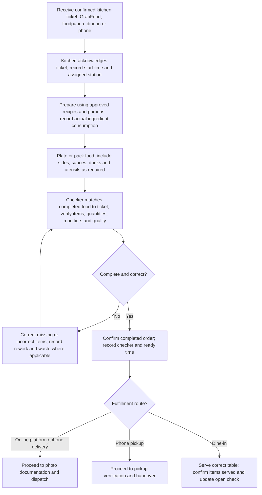
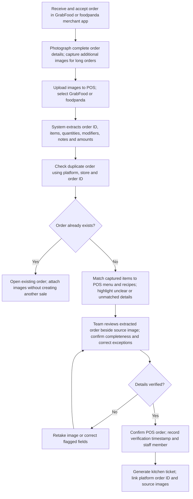
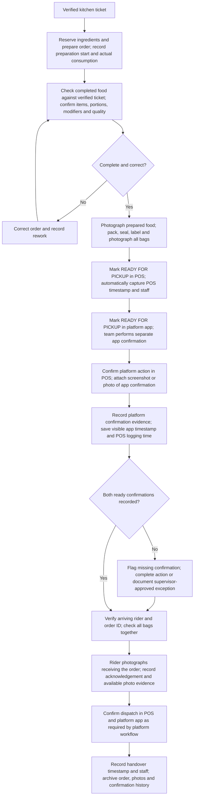
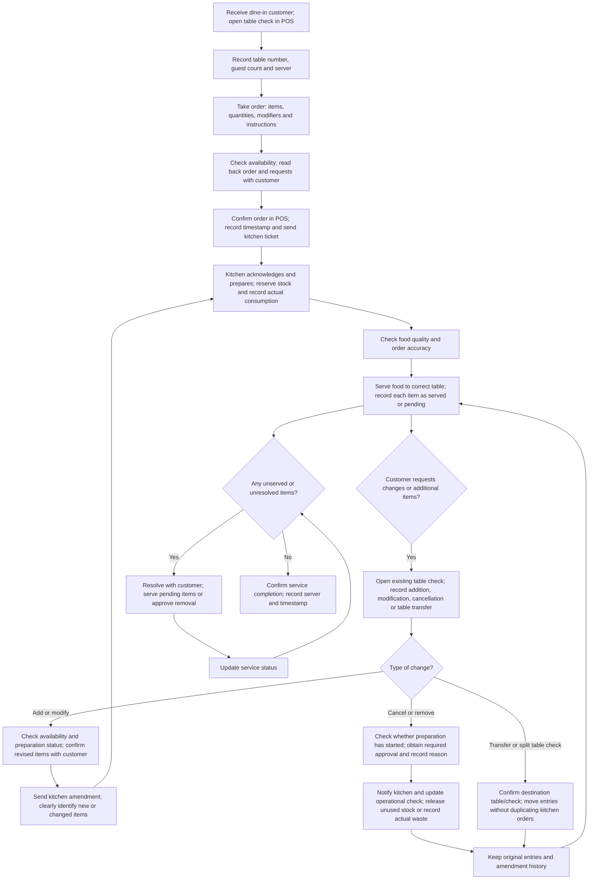

# STSWENG Group 02 Masterfile — Multi-brand POS

## Diagrams provided by the client

These diagrams describe intended future (TO-BE) workflows, not verified existing processes. They are not automatically approved MVP requirements.

> Accounting content is excluded from this conversion. Source pages 6–8 (expense accounting, platform commissions/settlements, and brand revenue/direct-cost accounting) are omitted. Financial branches in purchasing and dine-in are also omitted; the retained operational paths are connected directly.

## 1. Purchasing and receiving

Source: page 1. This is the ideal purchase process and recording flow the client wants the team to follow once the system exists, rather than the existing process.

The source phrase “incoming orders” remains undefined; this conversion does not choose whether it means supplier supply or customer demand.

## 2. Production process

Source: page 2. Raw-material issue, preparation, QC, accepted conversion and demand-guidance feedback remain distinct.

## 3. Kitchen preparation and fulfillment

Source: page 3. The client caption says “Assuming with API integration.”

## 4. Delivery-platform ordering without API integration

Source: page 4. The source includes OCR/image extraction, photo evidence and separate READY confirmations. These are client-intended steps; their presence here does not change the PRD's proposed deferrals.

### 4.1 Capture and verify the order

### 4.2 Prepare, confirm READY and dispatch

Continues from the verified kitchen ticket in §4.1. The financial receipt component of the source's “POS order receipt and kitchen ticket” node is omitted.

## 5. Dine-in ordering and service

Source: page 5. Billing, payments, account charges, invoices, financial closure and related correction branches are omitted. Operational table checks and amendment history are retained.

