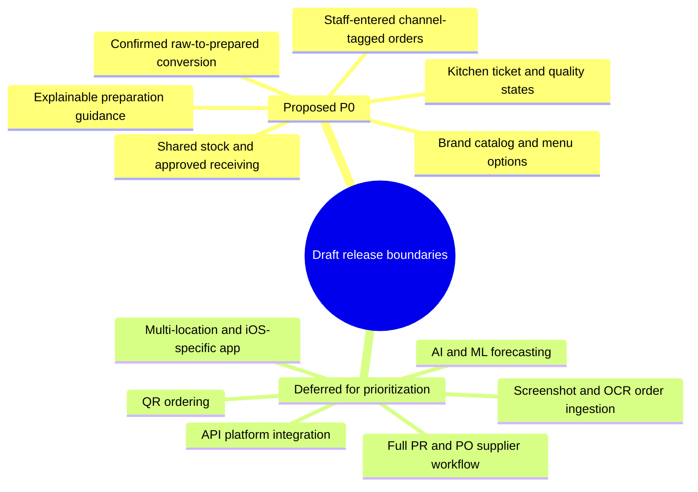
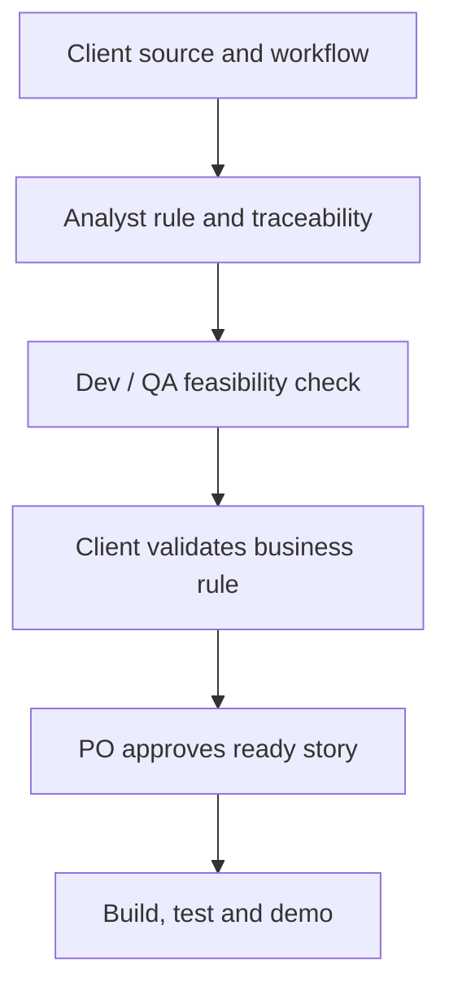

# Multi-brand POS & Food Operations System

> Markdown conversion of PRD v0.2. Accounting content has been omitted; original requirement and decision identifiers are preserved. Numbering gaps reflect omissions. All source draft/approval qualifications remain applicable.

STSWENG / GROUP 02

## Product Requirements Document

One kitchen · Multiple brands · Staff-facing academic proof of concept

| DOCUMENT CONTROL | DETAIL |
| --- | --- |
| Document version | PRD v0.2 — complete draft for client validation |
| Status | NOT APPROVED · Proposed academic MVP; open decisions and exclusions require validation |
| Prepared | 13 October 2026 (PHT) · STSWENG Group 02 |
| Business stakeholder | Sir King (King); formal sign-off authority to be confirmed |
| Project coordinator | Marc de Leon; formal approval role to be confirmed |
| Product Owner | Renzel Vince Eleydo |
| Contributors | Based on Business Analyst, Developer and QA team review inputs |
| Source baseline | Masterfile Formal Requirements Analysis v1.2; eight client TO-BE diagrams; Step 1–2 consolidation |

READ FIRST This is a complete draft for reviewing product needs and the proposed scope—not a claim that Sir King or the team has approved every listed feature, technical policy or release commitment.

### Purpose of this review

Please verify the proposed MVP boundary, operational workflows and outstanding decisions in Section 10. Technical architecture alternatives are flagged for team confirmation rather than being imposed on the client.

## At a glance

A practical operational tool for one shared kitchen serving multiple food brands. The academic pilot is proposed for approximately 2–3 brands, while the design should allow later expansion without promising multi-location functionality.

| BUSINESS OUTCOME | PROPOSED ACADEMIC SOLUTION |
| --- | --- |
| Fast order-to-kitchen workflow | Staff encode orders by brand/channel; kitchen receives a verifiable ticket with QC and handover states. |
| Reliable shared stock | Accepted receipts, counts, approved corrections and order consumption have traceable once-only effects. |
| Controlled food preparation | Weighed/recorded raw inputs become usable prepared portions only after QC acceptance; losses are visible. |
| Better preparation decisions | Simple advisory recommendations using available sales, stock and human review; no automatic stock posting. |
| Operational accountability | Authorized roles, protected recipes, audit trail and basic operational summaries. |

### What we need Sir King to validate

We are seeking confirmation of the proposed reduced release, especially the procurement deferrals, minimal dine-in behavior, stock-consumption and cancellation outcomes, role permissions, production/yield rules, and forecasting expectations. The team will own implementation mechanics and present relevant options where business policy is affected.

STATUS KEY Confirmed direction = supported business need. Proposed P0 = candidate minimum academic release. Conditional P0 = depends on feasibility/data/client input. Deferred/Excluded = team scope suggestion awaiting agreement. OPEN = no final decision.

### Document navigation

| SECTION | WHAT TO REVIEW |
| --- | --- |
| 1 | Business context, users, product goals and success evidence |
| 2 | Candidate MVP scope, non-goals and tradeoffs |
| 3 | Operating workflows and client-diagram coverage |
| 4–5 | All 30 FRs and 12 NFRs with testable intent and source decision gates |
| 6–8 | Data/integrity rules, acceptance scenarios and business rules |
| 9 | Four-sprint roadmap and delivery gates |
| 10 | Client decision sheet and D-01–18 reference |
| Appendices | BR-01–18 and BR-20, source register, change notes and scope trace |

## 1 \| Business context and product objectives

### 1.1 Current context and problem

The client runs a largely manual one-kitchen, multi-brand food operation in Iloilo. Shared ingredients and staff support several brands, while inventory counts can use individual pieces, packages and grams. The client described delivery platforms as major sources of orders. Detailed current-state (AS-IS) exceptions and approvals are not fully verified; the eight supplied process diagrams show intended future (TO-BE) behavior.

Conventional brand-separated records do not adequately describe one shared stock pool, its preparation into reusable portions, and subsequent consumption by different brands. The proposed system focuses on connecting these operational events without claiming to replace external merchant applications.

### 1.2 Product objectives

| ID | PRODUCT OBJECTIVE | PROPOSED EVIDENCE OF SUCCESS |
| --- | --- | --- |
| G-01 | Capture and route correct brand/channel orders | A configured staff order produces one appropriate kitchen ticket, with applicable duplicate controls. |
| G-02 | Explain inventory changes across brands | Balance can be reconciled to accepted receiving, authorized issue/consumption, production and adjustments. |
| G-03 | Make conversion/yield transparent | Actual input, accepted output, leftovers and documented loss can be traced without duplicate deductions. |
| G-04 | Support preparation decisions | An explainable proposal can be reviewed or overridden, with zero direct inventory effect. |
| G-05 | Protect sensitive operations | Unauthorized recipe/adjustment attempts are denied; consequential events leave evidence. |

Academic success should be judged by demonstrable workflows and approved acceptance criteria, not unsupported claims that waste or forecast error has already improved. Numeric targets must be determined against available data and real pilot devices.

### 1.3 Users and approval responsibilities

| USER GROUP | CANDIDATE RESPONSIBILITIES | AUTHORIZATION STATUS |
| --- | --- | --- |
| Order staff / cashier | Encode, verify and submit orders; inspect applicable ticket status | Final edit/cancel rights OPEN (D-03/04). |
| Kitchen preparer / checker | Process ticket, report QC failures, record authorized inputs/output | Actual role separation and sign-offs OPEN (D-03/07). |
| Inventory / receiving staff | Enter receiving and counts; inspect stock discrepancies | Approval rights OPEN (D-03/08/09). |
| Kitchen Head / supervisor | Review prep advice, QC, exceptions and selected adjustments | Scope of overrides/approvals OPEN (D-03/07/10). |
| Owner / manager | Oversee protected recipes, system permissions and consequential actions | Exact role/action matrix to be supplied by client (D-03). |

The system is staff-facing. Customer QR/self-ordering is an exploratory enhancement, not a confirmed academic MVP requirement.

## 2 \| Proposed release scope and non-goals

RELEASE STATUS The table below proposes a practical MVP based on all three team reviews. It does not represent a signed client decision. Individual FR IDs are retained even when some sub-capabilities are deferred.

| SCOPE | FUNCTIONAL CAPABILITY | LIMIT OF COMMITMENT |
| --- | --- | --- |
| Candidate P0 | 2–3-brand catalog, channel-specific sellable items and basic modifiers/fixed bundles | Exact brands, price versions and menu choices to be validated. |
| Candidate P0 | Staff-entered orders, manual delivery-platform fallback, duplicate checks, simple kitchen tickets/QC | Order life cycle and consumption policy OPEN. |
| Candidate P0 | Shared raw/prepared stock, accepted receiving, counts, reviewable adjustments and audit | Units, negative stock and approval rights OPEN. |
| Candidate P0 | Raw-to-prepared production: actual issue, batch hold/QC, accepted output and source-linked returns/loss | Actual recipe/yield/expiry business rules OPEN. |
| Conditional P0 | Basic explainable demand/prep guidance, review/override and shortage visibility | Subject to sales data, forecast scope and team estimate. |
| Conditional P0 | Simple dine-in channel/table reference and operational reports | Client must validate the minimal operational scope. |
| Proposed defer | OCR and photo chain; external APIs; station routing; advanced bundle selection; AI/ML; detailed expiry allocation | Desired TO-BE steps preserved in source register. |

### 2.1 Assumptions and boundaries

- One shared kitchen and a limited pilot brand catalog; future scale to more brands is a design consideration, not an additional pilot location.

- Manual channel-tagged entry works without GrabFood/foodpanda API access; an official merchant app remains the source for platform-controlled actions.

- Android-compatible proof of concept is sufficient; responsive web/PWA versus native and printer support await a real device feasibility decision.

- Only authorized and accepted physical events change stock; no recommendation produces another stock movement.

- Synthetic recipes and test sales may support development, but do not count as verified client recipes or evidence of forecasting accuracy.

### Figure 1. Team-proposed release boundaries

Every classification remains subject to appropriate scope approval. The accounting category from the source figure is omitted.

## 3 \| Core operating workflows

The following workflows are related but not one strict sequence: receiving feeds shared raw inventory; production creates prepared inventory; orders consume configured stock; history and usable stock inform non-posting guidance.

### Figure 2. Conceptual operational model

Specific stock-posting timing and permission rules remain OPEN. Only confirmed actions change inventory; forecasts, drafts and recommendations do not.

```mermaid
flowchart TD
    subgraph O["Orders and kitchen"]
        O1["Channel-tagged order entry"] --> O2["Confirm items and modifiers"]
        O2 --> O3["Issue kitchen ticket"]
        O3 --> O4["Check; correct if needed"]
        O4 --> O5["Ready / served / handed over"]
    end
    subgraph S["Shared stock"]
        S1["Inspect and accept receipts"] --> S2["Shared raw materials"]
        S2 --> S3["Confirmed stock conversion"]
        S3 --> S4["Usable prepared portions"]
        S4 --> S5["Record actual consumption"]
    end
    subgraph P["Preparation advice"]
        P1["Historical sales by brand/channel"] --> P2["Usable prepared stock and constraints"]
        P2 --> P3["Explainable recommendation"]
        P3 --> P4["Kitchen Head reviews / overrides"]
        P4 --> P5["Approved plan: no stock effect"]
    end
```

### 3.1 Minimal order-to-kitchen flow

Staff selects the brand and channel, enters the selected sellable configuration and quantity, verifies details and confirms the kitchen ticket. Staff acknowledges/prepares/checks it, records an exception or recheck if needed, then marks READY and finally served/handed over. READY and handover are separate events. Without an API, external platform cancellations and statuses require a defined manual update process.

### 3.2 Receiving and inventory reconciliation

Staff records the delivery source, relevant document and delivered/accepted/rejected quantities. Only authorized accepted quantities increase usable raw stock. Physical counts are compared with the ledger at a defined cutoff; a variance triggers review, not an accusation or automatic adjustment. Approved adjustments remain source-linked and auditable.

### 3.3 Raw-to-prepared conversion

An authorized production record captures physically issued raw inputs and units. A batch may be in preparation, held, rejected or accepted. Only accepted usable prepared outputs are added to prepared stock; recoverable leftovers and documented losses are separately accounted for. Later sales of prepared portions must not deduct their original raw ingredients again.

### 3.4 Preparation guidance

Available, correctly mapped sales history and usable prepared stock support a clear recommendation for what/how much to prepare. The proposed first release may use a simple baseline; the method, horizon, stock eligibility and shortage calculations must be validated. Authorized overrides record the reviewer and reason. A recommendation itself never changes stock.

### 3.5 Source workflow reconciliation

| SOURCE | CLIENT-INTENDED FLOW | PROPOSED ACADEMIC TREATMENT |
| --- | --- | --- |
| W-PUR | Purchasing, receipt inspection, accepted goods | Candidate P0: receipt/stock; full PR/PO purchasing workflow proposed deferred. |
| W-PREP | Plan → actual issue → prepare → QC → accept/rework | Candidate P0: reduced production; yield, approval, use-by and leftovers OPEN. |
| W-KIT | Ticket → prepare → verify → READY → handover | Candidate P0: simple ticket and QC; station routing/photos proposed deferred. |
| W-NOAPI | Platform order screenshot/OCR → check → dual READY → rider | Manual entry baseline; OCR, multi-photo, dual-platform READY not committed. |
| W-DINE | Check, amendments and service | Simple table/channel proposed; service completion and amendments unresolved. |

## 4 \| Functional requirements (FR-001–030)

Identifiers and business capabilities follow Masterfile Tab 7. Requirements below are written as testable draft behavior, with the proposed P0 classification and decision gate. FR IDs are not proof of approval or sprint commitment. PRD v0.1 “PRD-FR-###” maps directly to these canonical “FR-###” identifiers.

### Catalog, order entry and kitchen \| FR-001–010

| ID | PROPOSED VERIFIABLE BEHAVIOR | RELEASE / OPEN GATE | AC |
| --- | --- | --- | --- |
| FR-001 | Brand catalogs Distinct brand/channel catalogs for a 2–3-brand pilot; brand IDs stable and editable only by authorized staff. | Proposed P0 Gate: D-02 | AC-01 |
| FR-002 | Item variants, modifiers and bundles Variants as distinct sellable configurations; explicitly configured modifiers/fixed bundles with their own ingredient components. | Proposed P0, reduced Gate: D-02/D-06 | AC-01, AC-18 |
| FR-003 | Channel prices and availability Record brand, channel, merchant store and current confirmed item price; simple availability control. | Proposed P0, reduced Gate: D-02 | AC-01, AC-02 |
| FR-004 | Recipe confidentiality Separate inventory BOM quantities from restricted cooking/method instructions; never expose method via API without authorization. | Proposed P0 Gate: D-03/D-06 | AC-08 |
| FR-005 | Staff-entered orders Staff records channel-tagged order with selected item/option, quantity, external reference as applicable, and a clear confirmation step. | Proposed P0 Gate: D-04 | AC-01, AC-02 |
| FR-006 | External-order duplicate detection Prevent repeated platform/store/order entry; separately make network request submissions idempotent. | Proposed P0 Gate: D-04 | AC-02, AC-12, AC-19 |
| FR-007 | Order verification before ticket Encoder verifies mapped menu items and quantities before kitchen ticket; no mandatory OCR/photo dependency. | Proposed P0, reduced Gate: D-04/D-11/D-18 | AC-02 |
| FR-008 | Order amendments and history Retain order changes, cancellation actor/reason and status history; never silently erase posted consumption. | Proposed P0, reduced Gate: D-04/D-12 | AC-09, AC-17 |
| FR-009 | Kitchen ticket status / QC Ticket queue, preparation, checking, READY and handover/serve are distinct status events; QC failure goes back for recheck. | Proposed P0 Gate: D-04/D-13 | AC-06 |
| FR-010 | Basic dine-in table/check Dine-in channel/table reference for operational routing only; operational service handling only. | Conditional minimal P0 Gate: D-12 | AC-09 |

### Shared stock and receiving \| FR-011–017

| ID | PROPOSED VERIFIABLE BEHAVIOR | RELEASE / OPEN GATE | AC |
| --- | --- | --- | --- |
| FR-011 | Shared raw/prepared stock and units Shared raw and accepted prepared stock, one stock identity per item, canonical units and documented conversion factors. | Proposed P0 Gate: D-06 | AC-01, AC-04 |
| FR-012 | Auditable stock movements Trace immutable source-linked stock movements and corrections; ledger balances agree with committed movements. | Proposed P0 Gate: D-05 | AC-01, AC-11, AC-17 |
| FR-013 | Accepted-quantity receiving Capture delivery/accepted/rejected quantities; post accepted amounts once; retain source and receipt identity. | Proposed P0 Gate: D-09 | AC-03, AC-12 |
| FR-014 | Physical counts and variance Document physical count with observed and expected at a consistent cutoff; variance remains an unresolved observation until reviewed. | Proposed P0 Gate: D-08 | AC-05, AC-14 |
| FR-015 | Authorized stock adjustments Only authorized, reason-coded stock corrections post; immutable original event stays accessible. | Proposed P0 Gate: D-03/D-08 | AC-05, AC-08, AC-17 |
| FR-016 | Waste vs unresolved discrepancies Separate verified spoilage/rework loss from unexplained count discrepancy; avoid treating every variance as waste. | Proposed P0 Gate: D-08/D-07 | AC-05, AC-09 |
| FR-017 | Duplicate receipt / negative-stock guard Idempotent receipts and policy-controlled insufficient/negative stock; rollback all partial stock effects on failure. | Proposed P0 Gate: D-05/D-09 | AC-10, AC-11, AC-12 |

### Preparation and conversion \| FR-018–023

| ID | PROPOSED VERIFIABLE BEHAVIOR | RELEASE / OPEN GATE | AC |
| --- | --- | --- | --- |
| FR-018 | Draft production plans Create editable, non-posting preparation proposal; Kitchen Head review/override with reason where required. | Conditional P0, reduced Gate: D-07/D-10 | AC-07 |
| FR-019 | Actual raw-material issue to preparation Record physically issued raw inputs, units, batch/source references; issue is distinct from advisory planning. | Proposed P0 Gate: D-05/D-06 | AC-04, AC-15 |
| FR-020 | Actual output, loss and yield Record measured accepted outputs, recoverable leftovers, documented losses and comparison to approved yield basis. | Proposed P0 Gate: D-06/D-07 | AC-04, AC-15 |
| FR-021 | Rejected/held production batches Batch stays unavailable when held or rejected; record QC actor, rejection, rework and accepted output once. | Proposed P0, reduced Gate: D-07 | AC-15 |
| FR-022 | Batch and use-by traceability Trace batch ID and use-by date; do not promise automatic expiry blocking without remaining batch-quantity attribution. | Conditional P0 Gate: D-07 | AC-20 |
| FR-023 | No raw/prepared double deduction Sale consumes the correct prepared or direct-use raw/packaging components only once; conversion raw inputs never deducted again. | Proposed P0 Gate: D-05/D-06 | AC-01, AC-04, AC-09, AC-18 |

### Demand, reporting and security \| FR-024–030

| ID | PROPOSED VERIFIABLE BEHAVIOR | RELEASE / OPEN GATE | AC |
| --- | --- | --- | --- |
| FR-024 | Historical demand by brand/channel Preserve dated brand/channel/item order history with identity, cancellation flags and explicit missing-day/stockout quality flags. | Proposed P0 enabler Gate: D-14 | AC-07, AC-13 |
| FR-025 | Explainable preparation recommendation Simple explainable, date-stamped baseline of demand-to-preparation, visibly dependent on data quality, stock and approved factors. | Conditional P0 Gate: D-10/D-14 | AC-07, AC-13 |
| FR-026 | Recommendation review and override Human-reviewed forecast/plan override preserves before/after values, rationale and reviewer; does not post stock. | Conditional P0 Gate: D-10 | AC-07 |
| FR-027 | Shortage/excess/expiry signals Show stock shortfall/excess as advisory signals; avoid automatic buying or pretending item-level expiry is exact. | Conditional P0, reduced Gate: D-07/D-10/D-15 | AC-07, AC-13 |
| FR-028 | Operational reports: Operational count/order/quantity and inventory movement reporting only. | Conditional P0; Gate: D-01/D-14 | AC-03, AC-05 |
| FR-029 | Role-based privileged actions Enforce owner-approved permissions in API and UI; protect recipes and stock approvals regardless of interface. | Proposed P0 Gate: D-03 | AC-08 |
| FR-030 | Consequence/event audit history Record actor, event time, source IDs, outcome/reversal provenance and denial of restricted actions where needed. | Proposed P0 Gate: D-17/D-18 | AC-08, AC-17 |

## 5 \| Non-functional requirements (NFR-001–012)

Each NFR retains its Masterfile domain. Criteria below describe how to verify the quality attribute without inventing approved numerical thresholds or claiming that a technology stack has already been selected.

| ID | QUALITY ATTRIBUTE | PROPOSED VERIFICATION | OPEN INPUT |
| --- | --- | --- | --- |
| NFR-001 | Android task usability | Task trial: trained staff enter/check an example order on actual Android-compatible target, including error correction; time/error rate to be agreed. | D-13/D-17 |
| NFR-002 | Retry/idempotency reliability | Simulate lost response, duplicate submit and retry; exactly one logical committed event and recover original outcome. | D-17 |
| NFR-003 | Transactional stock integrity | Simultaneous order/receipt/issue and partial failure; atomic posting and ledger balance consistency on committed events. | D-05/D-17 |
| NFR-004 | Recipe confidentiality / RBAC | Positive/negative permission tests for recipes, privileged adjustments and role-by-role API response filtering. | D-03 |
| NFR-005 | Privacy and least-necessary data | Document data-minimization and retention; test visibility, purge and protection of customer/order screenshots if collected. | D-18 |
| NFR-006 | Durable audit records | Audit actor/source/time/correction association, no silent edit/delete; retention period must be authorized. | D-17/D-18 |
| NFR-007 | Maintainability | Peer review and repeatable unit/integration tests for key domain services and a documented maintainable module boundary. | Dev convention |
| NFR-008 | Channel reference interoperability | Stable channel/store/order identity and documented import/export or future integration seam without claiming an operational API. | D-11 |
| NFR-009 | Accessible touch workflow | Readable touch targets, contrast/status cues and staff observation on approved Android device. | D-13/D-17 |
| NFR-010 | Testable stories | Each ready user story has fixture, preconditions, event, expected state/data result and negative path. | Analyst/QA gate |
| NFR-011 | Backup and recovery | Demonstrate backed-up records can be restored; schedule/RPO/RTO are proposals until agreed. | D-17 |
| NFR-012 | Device/network/deployment support | Verify approved browser/device, Wi-Fi failure handling, printer fallback and whether offline actions are permitted. | D-13/D-17 |

### 5.1 Numerical criteria require approval

Suggested values such as 2-second confirmation, five concurrent devices, daily backup, RPO 24 hours and RTO 4 hours appeared in technical reviews as examples—not accepted service-level commitments. Before test sign-off, the team must specify device, network, test workload, observable result, metric, acceptance limit and evidence for each applicable NFR (D-13/D-17).

## 6 \| Data model, transaction safety and unresolved technical policy

### 6.1 Minimum conceptual data groups

| DATA GROUP | MINIMUM RELEVANT FIELDS / RELATIONSHIPS |
| --- | --- |
| Business, brand and channel | Business/kitchen ID, brand ID, channel, optional merchant store, channel-specific sellable item and current approved price. |
| Sellable catalog and recipe | Sellable item/variant; configured component quantities, units, recipe/BOM reference; protected method data stored under stricter permissions. |
| Orders and kitchen | Order ID; source channel/store/reference; line selections/quantities; order/ticket/QC states; actors/timestamps; reasoned changes. |
| Stock and receiving | Single canonical item identity, raw/prepared classification, base unit, source documents, delivered/accepted quantities, movements and physical counts. |
| Production batch | Batch ID; actual input issue; source reference; measured outputs; accepted/held/rejected status; rework, leftovers, losses and relevant expiry data. |
| Demand advice | Dated input series and quality flags; proposed horizon, stock inputs, method/assumptions, result, reviewer/override and reason. |
| Security and audit | Role/action authorization, event actor/time, source key, idempotency key, original/reversal connection and access restrictions. |

### 6.2 Physical-stock invariants

- Only accepted deliveries and accepted prepared outputs increase usable stock through their respective authorized events.

- Unaccepted production output, hold/reject, plans and recommendations do not add available stock.

- No physical event is posted twice by retries, concurrent requests, a later sale.

- Actual raw issue and accepted prepared output remain distinct; standard BOM assumptions are not labeled as measured actual usage without measurement.

- Corrections are attributable; original posted events are not silently rewritten or deleted.

- Already-consumed stock reclassified as cancellation waste does not receive a second net deduction.

- Expiry blocking cannot be claimed unless inventory records can establish the remaining eligible quantity.

- Unexplained differences are variance awaiting review, not automatically theft or waste.

### 6.3 Order stock-posting policy — OPEN (D-05)

| EVENT | ALTERNATIVE A: TECHNICAL REVIEW | ALTERNATIVE B: DEVELOPER REVIEW | COMMON ACCEPTANCE OUTCOME |
| --- | --- | --- | --- |
| Ticket confirmed | Deduct expected BOM quantities immediately. | Reserve quantities, do not reduce physical on-hand. | One authenticated commitment, with traceable source. |
| Kitchen prep starts | Only separately record deviations. | Consume reserved quantities once. | Physical quantities never deducted twice. |
| Cancel before prep | Reverse original sale deduction. | Release unconsumed reservation. | Restore/release exactly what was not physically used. |
| Cancel after prep | Retain consumption; classify waste/recovery. | Retain consumption; document authorized recovery/loss. | No duplicate net WASTE posting for the same portion. |
| READY / handover | No new stock deduction. | No new stock deduction. | Separate readiness and handover states. |

DECISION RULE Lead Dev selects and documents the technical event/state contract; Analysts check the eight workflows and client business intent; QA verifies cancellation, concurrency, idempotency and stock balance. Sir King confirms business outcomes where policy changes. No model above is approved in this PRD.

### 6.4 Item and production subtleties

A sellable item may contain prepared components, direct-use raw ingredients and tracked packaging. The applied component quantities must remain associated with the original transaction even after a recipe is edited. Multiple production inputs/outputs, usable returns and process-added weight require an explicitly defined yield basis. Item-level batch labels alone do not guarantee exact FEFO or expiry-controlled availability.

## 7 \| Acceptance scenarios and review evidence

AC-01–08 retain the original Masterfile identities. AC-09–20 are one consolidated proposal replacing the QA report’s two conflicting candidate numbering sets. Each scenario requires a Given/When/Then fixture, initial quantities, actors, expected UI/status, net ledger effects and audit evidence before formal test acceptance.

### 7.1 Existing Masterfile acceptance scenarios (identities preserved)

| ID | EXPECTED OBSERVABLE RESULT | OPEN QUALIFICATION |
| --- | --- | --- |
| AC-01 | Two brands consume one shared item with correct brand/channel and stock ledger. | Approved recipe BOM, units, deduction event. |
| AC-02 | Repeated platform/store/order ID creates one confirmed order and inventory effect. | Uniqueness key and missing-reference policy. |
| AC-03 | Synthetic 10 ordered / 8 delivered / 7 accepted increases stock by 7 only. | Receipt authority, partial/reject states; synthetic numbers are NOT client facts. |
| AC-04 | Actual input issue, accepted prepared output and sale create each authorized physical stock effect exactly once. | BOM, batch yield, posting and reversal rules. |
| AC-05 | Synthetic expected 80 vs counted 75 creates unresolved difference of 5, no assigned cause. | Sign convention: observed − expected would be −5; policy remains open. |
| AC-06 | Failed kitchen QC prevents READY until correction and recheck. | Checker rights, rework/waste handling. |
| AC-07 | Prep recommendation and override record rationale without moving stock. | Baseline, period, history and reviewer authority. |
| AC-08 | Unauthorized recipe view or adjustment approval is denied and logged. | Owner-approved role/action matrix. |

### 7.2 Candidate additional scenarios — not yet approved

| ID | PROPOSED TEST / EXPECTED RESULT | RELATED REQUIREMENT / DECISION |
| --- | --- | --- |
| AC-09 | Cancel before/during/after preparation: Apply approved reservation/consumption/recovery rule exactly once; actor, stage, reason and resulting balance remain traceable. | FR-008/016/023; D-04/D-05 |
| AC-10 | Insufficient/negative stock: Order, production issue and adjustment each follow their approved shortage/warn/override policy; no data loss or hidden negative balance. | FR-017/023; D-05 |
| AC-11 | Concurrent transactions: Two simultaneous operations never corrupt balances or partially post accepted operations; conflict handling is deterministic and audited. | FR-012/017; D-05/D-17 |
| AC-12 | Lost response and retry: The same logical request retried after a timeout returns/retrieves its existing result; no duplicate order, receipt or production stock event. | FR-006/013/017; D-04/D-09 |
| AC-13 | Forecast with missing/poor data: History absence, unrecognized item, stockout or stale count causes explicitly labeled limitation; recommendation does not post stock. | FR-024–027; D-10/D-14 |
| AC-14 | Physical count during service: Expected balance reconciles at an approved cutoff/line timestamp; unapproved count posts no adjustment. | FR-014/015; D-08 |
| AC-15 | Batch hold, rework and rejection: Held/rejected output never becomes usable stock; accepted outputs and returns post once; extra rework input has separate trace. | FR-019–022; D-06/D-07 |
| AC-16 | External-platform cancellation: Staff records a platform-side cancellation without API sync, preventing falsely fulfilled or duplicated kitchen/stock states. | FR-005/008/009; D-04 |
| AC-17 | Correction, reversal and rollback: Mistaken posted event is corrected through authorized compensating/reversal trace; a failed multi-line transaction leaves no partial stock effect. | FR-012/015/030; D-05/D-08 |
| AC-18 | Historical applied BOM: Changing a current recipe or item configuration does not change historical applied components or posted stock movements. | FR-002/023/030; D-06 |
| AC-19 | Missing external ID and lookalike orders: Missing-ID exception follows approved policy; same-platform duplicate is blocked, distinct legitimate lookalikes remain distinct. | FR-005/006; D-04 |
| AC-20 | Expiry/hold eligibility (conditional): If expiry exclusion is in scope, unavailable batches cannot be sold or counted usable; mechanism has valid remaining-quantity evidence. | FR-021/022/027; D-07 |

Test data examples such as “10 ordered / 8 delivered / 7 accepted” and “80 expected / 75 counted” are synthetic acceptance fixtures, not claims about actual client transactions.

## 8 \| Business-rule summary and exception controls

Business rules BR-01–18 and BR-20 are retained as source-traceable principles, not blanket approvals. Derived rules, client TO-BE procedures and unconfirmed policy choices remain qualified in the full table below.

| ID | CONTROLLED SOURCE / BUSINESS RULE | OPEN QUALIFICATION |
| --- | --- | --- |
| BR-01 | Orders are entered in POS before kitchen preparation; platform orders may originate externally. | Exceptional/offline handling and final confirmation actor remain OPEN (D-04). |
| BR-02 | Manual channel-tagged GrabFood/foodpanda encoding remains possible without APIs. | platform/store identifiers and platform-side edits. |
| BR-03 | Recipes are confidential and owner-authorized. | Supply role matrix and NDA access process. |
| BR-04 | Only physically accepted deliveries increase usable stock. | partial/rejected receiving and who authorizes it. |
| BR-05 | Requested, ordered, delivered, accepted and posted quantities are separate records. | units, linkage and source metadata. |
| BR-06 | Unexplained count variance is not automatically waste or theft. | investigation codes and closures. |
| BR-07 | Production recommendations/drafts do not change physical stock. | reservation and issue events. |
| BR-08 | Only accepted usable output enters prepared inventory. | batch QC and rework/hold policy. |
| BR-09 | Conversion and later sale cannot duplicate raw-material stock reduction. | Confirm posting/reversal boundary (D-05/06). |
| BR-10 | Counts use mixed units (pieces, packs, loose grams). | precision and conversions. |
| BR-11 | Corrected kitchen orders return to checker before READY. | roles and waste- recording rules. |
| BR-12 | Kitchen READY and served/handed over are distinct states. | Status transition contract. |
| BR-13 | Same platform/store/order reference must not duplicate normalized orders. | Resolve missing IDs and retries. |
| BR-14 | Prep quantity planning considers usable prepared stock, not raw totals alone. | Determine reserved/WIP/expired stock treatment. |
| BR-15 | Kitchen Head reviews recommendations; overrides retain reason. | authority and mandatory rationale. |
| BR-16 | Purchasing formula must not be coded before 'incoming orders' is defined. | Resolve whether incoming supplier supply or customer demand. |
| BR-17 | Seven-day buying and additional three-day buffer were examples only. | real replenishment policy. |
| BR-18 | OCR/order-image extraction is not a prerequisite to manual order entry. | Client decides scope and accuracy target. |
| BR-20 | Dine-in changes preserve original entries and amendment history. | Determine minimum amendments. |

## 9 \| Academic delivery and readiness gates

### 9.1 Masterfile schedule (proposed team baseline)

| WINDOW | TARGET WORK | READINESS CONSTRAINT / COURSE GATE |
| --- | --- | --- |
| Prep · Oct 11–13 | Requirements, PRD drafts, MCO1/MCO2, repo/CI groundwork | MCO1/MCO2 due Oct 13. |
| Sprint 1 · Oct 14–27 | Approved catalog/order vertical slice and CI | MCO3 on Oct 27; Oct 23 demo feature cutoff. |
| Sprint 2 · Oct 28–Nov 10 | Inventory, counts, conversion if validated | No implementation without posting contract/recipes. |
| Sprint 3 · Nov 11–24 | Demand baseline, integration and QA | MCO4 test plan due Nov 13. |
| Sprint 4 · Nov 25–Dec 8 | Remaining approved scope, regression, tested PoC | MCO5 final presentation Dec 8. |

These windows are the Masterfile planning targets, not proof that all listed features fit the available capacity. The 17-page technical review assumed six two-week sprints and estimated more effort than that assumption; the Developer review assumed six weeks. Lead Dev must re-estimate story-level work against the actual four- sprint plan and course checkpoints.

### 9.2 Story readiness and quality controls

| GATE | MINIMUM EVIDENCE BEFORE APPROVAL | RESPONSIBLE REVIEW |
| --- | --- | --- |
| PRD draft content | Each candidate capability has scope label, source, minimum observable result, linked D/BR and explicit limitation. | Analysts; PO reviews |
| Order/kitchen build | Approved state outcomes and internally tested transaction model; no disputed stock trigger presented as final. | Lead Dev + Analysts + QA; PO |
| Shared stock/receiving build | Units, posting once, correction authority, duplicate requests, negative-stock rule per action. | Lead Dev + QA; client policies |
| Production build | Authorized or identified synthetic BOM; issue/accept tests, yield/QC, batch held and returned stock rules. | Analysts + Dev + QA; client outcome |
| Demand acceptance | Sales history identified and inspected; baseline and cold-start accepted; data-quality/stock limitations shown. | Analysts + QA + PO |
| Client PRD review | Clear proposed P0 and traced scope boundaries; concise decision list. | PO → King / authorized signer |
| Story enters sprint | Actor, inputs, permissions, flow/exception, fixtures, AC, estimate, dependency, source approval and PO signoff. | Whole team review; PO acceptance |

### Figure 3. From source evidence to development-ready stories

Partial groundwork may proceed without claiming unresolved requirements are approved. Draft specifications can advance now; unresolved business rules do not become approved implementation commitments.

## 10 \| Client validation and outstanding decisions

CLIENT ACTION REQUEST Please confirm the proposed release boundary and answer the questions below where possible. “Needs discussion” is an acceptable response. The technical implementation proposal will be documented separately by the engineering team. Silence is not approval.

### 10.1 Priority questions for Sir King

| REF | DECISION REQUIRED | WHY IT MATTERS |
| --- | --- | --- |
| D-02 | Which 2–3 brands, menu versions and sales channels should be used for the pilot? | Determines real catalog and testing fixtures. |
| D-03 | Which staff roles may see recipes, approve adjustments, confirm batches and view audit records? | Required to configure secure access. |
| D-04 / D-05 | At which business point should ingredients count as consumed? What should happen before/after preparation when an order is cancelled? | Prevents incorrect stock and cancellation behavior. |
| D-06 / D-07 | Which recipe/unit/yield and QC/hold/rework/use-by rules should be demonstrated? | Required to validate real stock conversion. |
| D-08 / D-09 | Who accepts deliveries, performs counts and authorizes stock corrections? What happens to rejected/held goods? | Defines receiving/count approval behavior. |
| D-10 / D-14 | What planning horizon, sales history and fallback should guide preparation recommendations? | Sets a feasible and meaningful baseline. |
| D-12 | Is minimal dine-in order/table handling acceptable for the MVP? | Defines the operational dine-in boundary. |
| D-13 / D-17 | Which real Android devices, networks, printers and service/recovery expectations should be tested? | Defines pilot platform and measurable NFRs. |
| D-16 / D-18 | Who may formally approve the PRD, and may order screenshots or other customer data be stored? | Defines governance and data-protection controls. |

### 10.2 Tracked decision register (D-01–D-18)

| ID / MASTERFILE PRIORITY | ACCOUNTABLE DECISION OWNER | QUESTION / AFFECTED IMPLEMENTATION GATE |
| --- | --- | --- |
| D-01 · P0 | Client + PO | Approve proposed P0/non-goals; PRD scope boundary. |
| D-02 · P0 | Client | pilot brand IDs, effective menus, channel prices.; Catalog/order pilot configuration (Sprint 1) |
| D-03 · P0 | Client | Issue role/action matrix, approval authority and recipe/NDA policy.; Role/security and privileged workflow stories (Sprint 1 and onward) |
| D-04 · P0 | Client + Analysts | order acceptance, state changes, cancellations, corrections boundary.; Order-to-kitchen lifecycle and cancellation tests |
| D-05 · P0 | Client + Analysts + Dev | stock reservation, consumption, reversals and negative-stock policy.; Integrated order/inventory posting and negative-stock tests |
| D-06 · P0 | Client | authorized recipes, yields, units, substitutions and losses.; Recipe/BOM, units, conversion and domain acceptance |
| D-07 · P0 | Client | batch, use-by, hold, rework and disposal policy.; Production batch/QC/expiry acceptance |
| D-08 · P0 | Client | counts cadence, variance resolution and stock adjustment sign-off.; Count/adjustment acceptance and audit |
| D-09 · P0 | Client | receiving evidence, partial/rejected goods and accepting roles.; Receiving acceptance |
| D-10 · P1 | Client + Analysts | demand horizon, cold start, data sufficiency, baseline and override.; Demand-planning story acceptance (Sprint 3 candidate) |
| D-11 · P1 | Client + PO | OCR/photo evidence and platform READY workflow scope.; Whether platform evidence/OCR enters P0 |
| D-12 · P0 | Client + PO | Clarify dine-in service completion and check amendment boundaries; whether the proposed minimal dine-in P0 is acceptable. |
| D-13 · P1 | Client + Dev | devices, connectivity, peripherals and pilot conditions.; Device/network, kitchen ticket and pilot runtime |
| D-14 · P0 | Client | Provide real sales/stock samples; specify operational reports; data fitness and operational report/forecast validity. |
| D-15 · P1 | Client | purchasing 'incoming orders' and PR/PO workflow deferral.; If any shopping-list/procurement recommendation is included |
| D-16 · P0 | Client + PO | Document validation method, signer and formal approval evidence.; Written requirement/scope approval and named reviewer |
| D-17 · P1 | Dev + QA + Client | measurable NFR thresholds, transaction load, backup/recovery.; Objective NFR acceptance thresholds and test loads |
| D-18 · P1 | Client + PO + Dev | privacy boundary for customer/order images.; Personal-data, screenshot and retention handling |

### 10.3 Proposed review outcome record

| REVIEW ITEM | DECISION / RESPONSE |
| --- | --- |
| Scope / MVP boundaries | ☐ Agree as proposed ☐ Agree with changes ☐ Requires discussion |
| Orders, stock and production | ☐ Agree with business outcomes ☐ Changes required |
| Demand planning and reporting | ☐ Agree with limited baseline ☐ Changes required |
| Outstanding data and permissions | ☐ Will provide / identify owner ☐ Need follow-up |
| Authorized approver and evidence | Name / role: __________________ Date: ____________ |

Completing this response record is evidence of review only. Formal sign-off is effective only when the authorized approver, accepted revision, explicit scope decisions and date are recorded according to the agreed process.

## Appendix A \| Evidence, traceability and terminology

### A.1 Source register

| SOURCE | HOW IT IS USED | RELIABILITY LIMIT |
| --- | --- | --- |
| [M] Masterfile (7th tab: Formal Requirements Analysis v1.2) | Current controlled business context; FR-001–030, NFR-001–012, BR-01–18 and BR-20, D-01–18, AC-01–08; four-sprint roadmap. | Contains proposed and open entries, not a signed baseline. |
| [T] October 9 client transcript and meeting context | Client-stated priorities, Android compatibility, recipe confidentiality, manual channel entry and illustrative planning factors. | Automatic transcription may contain errors; check consequential wording. |
| [W] Eight client TO-BE diagrams | W-PUR / W-PREP / W-KIT / W-NOAPI / W-DINE. Accounting workflows omitted from this conversion. | Future intended workflow, not automatically AS-IS or P0. |
| [MENUS] Candidate brand menus | Gamcheon, Aurelia’s Inasal and King Kungs Kafé product/price references. | Candidate source materials; not approved recipes/yields/current pilot set. |
| [A] 17-page technical review (TF-01–TF-55) | Detailed feasibility, scope-cut candidates and one stock model. | Uses incorrect six-sprint planning assumption; design not approved. |
| [DEV] Four-page developer feasibility review | Alternative reserve-then-consume model, quality/forecast controls and effort caveats. | Approx. six-week assumption not a confirmed commitment. |
| [QA] 32-page QA readiness report (QA-01–37) | Edge cases, corrected scenario coverage, NFR quality concerns. | Preliminary; conflicting candidate AC numbering and some incorrect NFR mappings. |
| [RB] Step 1 and Step 2 consolidation | Crosswalk and controlled reconciled minimum behavior, open conflicts and candidate AC-09–20. | Internal advisory input; no replacement for client decisions. |

### A.2 Key terms

| TERM | MEANING |
| --- | --- |
| Shared inventory | One stock pool serving orders from multiple brands in the same kitchen. |
| Raw material / prepared stock | Purchased inputs versus accepted, usable converted portions or derivatives. |
| BOM / recipe components | Structured item/quantity requirements; preparation instructions may be confidential. |
| Yield and variance | Approved yield ratio or comparison basis; physical-count variance is not automatic waste. |
| Reservation / consumption | Reservation reduces availability without necessarily moving on-hand; consumption records an authorized physical-use event. The project has NOT chosen a model. |
| Advisory demand planning | A reviewable suggestion of what/how much/when to prepare; no physical stock posting. |
| P0 / P1 / P2 | Priority recommendations for academic release and subsequent scope; P0 is not automatically client approved. |
| KDS / READY | Kitchen display/status and prepared-order completion. |

### A.3 Changes from PRD v0.1

Retains the original 30 FR and 12 NFR identities while clarifying priority versus approval; keeps the competing stock models open; adds one consolidated candidate AC-09–20 register; and aligns proposed delivery to the four-sprint Masterfile roadmap. Client-reported sample sales data has not been inspected, and technical defaults are not approved business policy. Accounting content is omitted from this conversion.

