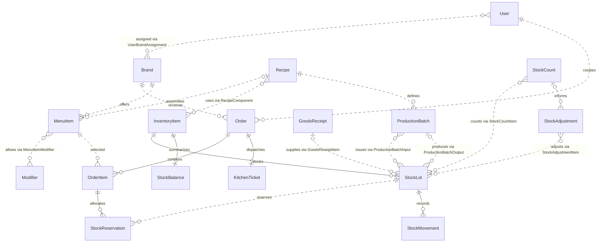

# Multi-brand POS schema overview

Source: [multi_brand_pos.dbml](multi_brand_pos.dbml).
Implementation: [schema.prisma](../prisma/schema.prisma).

This simplified diagram shows the main entities. Relationships labeled
`via` summarize paths through omitted junction or detail tables; they do
not represent direct foreign keys. Event history, audit logs, modifier
components, receipt/count/adjustment lines, and production input/output/
return/loss details remain in the full Prisma schema.

The circle means optional participation; a bar means one; a crow's foot
means many. For example, an order can have zero or one kitchen ticket,
while each ticket belongs to exactly one order. Draft parents can have
zero detail rows. Solid lines show dependent records; dotted lines show
associations and summarized paths.

The Prisma schema includes all 33 tables and 18 enums from the DBML.
Model and enum names use PascalCase; `@@map` preserves the original
database names. Column names, decimal precision, timestamp types,
nullability, defaults, unique constraints, indexes, and foreign keys
follow the source. Foreign keys explicitly use PostgreSQL's default
`NO ACTION` behavior for updates and deletes.

UUIDs remain application-assigned. `modified_at` has an initialization
default, without Prisma's `@updatedAt`; the application or a database
trigger must update it explicitly.

Rules expressed as DBML notes still require backend validation: menu/
modifier pairing, production recipe types and yields, matching items
and lots across related records, exactly one input or output for a
production loss, and append-only event/audit/stock movement records.
Stock movements, lot quantity caches, and item balances must update in
the same transaction. Reservations are a subset of usable stock;
expired lots must be excluded from availability.
